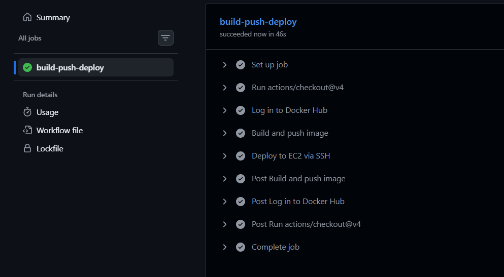

# Student Attendance Tracker

A full-stack student attendance management web application built with a **FastAPI + SQLite** backend and a **React + Vite** frontend.

---

## 1. Project and Team

- **Project Name:** Student Attendance Tracker (`student-attendance-tracker`)
- **Team Size:** 3 Members

### Team Members & Endpoint Distribution

| Member Name | Role / Focus | Endpoints & Modules Built | Description |
|:---|:---|:---|:---|
| **Melvin** | Backend & DB | **A2**, **E2** | `POST /login` (Authentication & JWT generation)<br>`POST /attendance` (Mark student attendance with auth) |
| **Gokul** | Backend & API | **A1**, **E1** | `POST /register` (Teacher registration with Argon2 hashing)<br>`GET /attendance` (Fetch teacher's attendance records) |
| **Naman** | Backend & DevOps | **A3**, CI/CD | `POST /refresh` (Generate new access token using refresh token)<br>Docker containerization & GitHub Actions EC2 deployment |

---

## 2. Live App

- **Live Application / API Base URL:**  
  [http://YOUR_EC2_PUBLIC_IP:8001](http://YOUR_EC2_PUBLIC_IP:8001)

- **Interactive Swagger Documentation:**  
  [http://YOUR_EC2_PUBLIC_IP:8001/docs](http://YOUR_EC2_PUBLIC_IP:8001/docs)

*(Note: Replace `YOUR_EC2_PUBLIC_IP` with your team's AWS EC2 instance public IPv4 address, e.g. `http://54.210.xxx.xxx:8001`)*

---

## 3. How to Run It

Follow the steps below to run the project on a fresh laptop.

### Prerequisites
- **Python 3.10+**
- **Node.js 18+** & **npm**
- **Docker** (optional, for containerized run)

---

### Run Backend (FastAPI)

1. Open a terminal and navigate to the `backend` folder:
   ```bash
   cd backend
   ```

2. Create and activate a Python virtual environment:
   - **Windows (PowerShell):**
     ```powershell
     python -m venv venv
     .\venv\Scripts\Activate.ps1
     ```
   - **macOS / Linux:**
     ```bash
     python3 -m venv venv
     source venv/bin/activate
     ```

3. Install required Python packages:
   ```bash
   pip install -r requirements.txt
   ```

4. Start the FastAPI development server on port **8001**:
   ```bash
   uvicorn main:app --reload --port 8001
   ```
   > Swagger UI docs are live at `http://127.0.0.1:8001/docs`

---

### Run Frontend (React + Vite)

1. Open a separate terminal and navigate to the `frontend` folder:
   ```bash
   cd frontend
   ```

2. Install Node dependencies:
   ```bash
   npm install
   ```

3. Start the Vite development server:
   ```bash
   npm run dev
   ```
   > Open `http://localhost:5173` in your browser.

---

### Run with Docker

To build and run the entire backend service in a standalone container:

1. Build the Docker image from the project root:
   ```bash
   docker build -t student-attendance-tracker .
   ```

2. Run the Docker container with persistent SQLite volume mounting:
   - **Windows (PowerShell):**
     ```powershell
     docker run -d -p 8001:8001 -v ${PWD}/backend:/app --name attendance-app student-attendance-tracker
     ```
   - **Linux / macOS:**
     ```bash
     docker run -d -p 8001:8001 -v $(pwd)/backend:/app --name attendance-app student-attendance-tracker
     ```

3. Access the containerized application at `http://localhost:8001/docs`.

---

## 4. API Contract

### Completed Endpoints Table (A1–A3, E1–E2)

The FastAPI server runs on port **8001** with CORS enabled.

| # | What it does | Method | Path | Request Body / Params | Success Code | Who Built |
|:---:|:---|:---:|:---|:---|:---:|:---:|
| **A1** | Register a new teacher | `POST` | `/register` | **JSON Body:**<br>`{"username": "john_doe", "email": "john@school.edu", "password": "securepassword123"}` | `201` | Gokul |
| **A2** | Login and generate JWT access and refresh tokens | `POST` | `/login` | **JSON Body:**<br>`{"email": "john@school.edu", "password": "securepassword123"}` | `200` | Melvin |
| **A3** | Generate a new access token using a refresh token | `POST` | `/refresh` | **Query Param:** `refresh_token`<br>*(or JSON Body: `{"refresh_token": "..."}`)* | `200` | Naman |
| **E1** | Get all attendance records created by the logged-in teacher | `GET` | `/attendance` | **Header:** `token: <access_token>`<br>**Body:** *None* | `200` | Gokul |
| **E2** | Mark a student's attendance and associate it with the logged-in teacher | `POST` | `/attendance` | **Header:** `token: <access_token>`<br>**JSON Body:**<br>`{"student_name": "Jane Smith", "roll_no": "CS101", "attendance_date": "2026-11-23", "status": "present"}` | `200` *(or `201`)* | Melvin |

---

### Error Rules Table

The API validates business invariants and raises explicit HTTP exceptions with explanatory messages:

| Rule | HTTP Status | Detail Message Example |
|:---|:---:|:---|
| Registering with an email that already exists | `409` | `{"detail": "Email already registered"}` |
| Logging in with incorrect email or password | `401` | `{"detail": "Invalid email or password"}` |
| Using an invalid or expired access token | `401` | `{"detail": "Invalid or expired token"}` |
| Using an invalid or expired refresh token | `401` | `{"detail": "Invalid Token"}` |
| Accessing attendance records without authentication | `401` | `{"detail": "Invalid or expired token"}` |
| Sending missing or empty required fields | `422` | `{"detail": [{"loc": ["body", "student_name"], "msg": "Field required"}]}` |
| Registering with an invalid email format | `422` | `{"detail": "Invalid email format"}` |
| Providing a status other than present or absent | `422` | `{"detail": "Status must be present or absent"}` |

---

## 5. Database

The application utilizes an SQLite database (`Student.db`) with two primary relational tables:

### Table 1: `users`
Stores registered teachers and authentication credentials.

| Column | Type | Constraints | Description |
|:---|:---|:---|:---|
| `id` | `INTEGER` | PRIMARY KEY, AUTOINCREMENT | Unique teacher identifier |
| `username` | `VARCHAR` | NOT NULL | Display name / username |
| `email` | `VARCHAR` | UNIQUE, NOT NULL | Teacher's unique email address |
| `hashed_password` | `VARCHAR` | NOT NULL | Argon2 salted password hash |
| `created_at` | `DATETIME` | DEFAULT CURRENT_TIMESTAMP | Account creation timestamp |

### Table 2: `attendance`
Stores daily attendance records created by teachers.

| Column | Type | Constraints | Description |
|:---|:---|:---|:---|
| `id` | `INTEGER` | PRIMARY KEY, AUTOINCREMENT | Unique attendance record ID |
| `user_id` | `INTEGER` | FOREIGN KEY (`users.id`), NOT NULL | ID of teacher who recorded attendance |
| `student_name` | `VARCHAR` | NOT NULL | Full name of the student |
| `roll_no` | `VARCHAR` | NOT NULL | Student's unique roll number |
| `attendance_date` | `DATE` | NOT NULL | Attendance date (YYYY-MM-DD) |
| `status` | `VARCHAR` | NOT NULL | Attendance status (`present` or `absent`) |
| `created_at` | `DATETIME` | DEFAULT CURRENT_TIMESTAMP | Record submission timestamp |

---

## 6. Screenshots

### Screenshot 1: Teacher Registration
  
*Teacher registration form allowing new educators to create accounts with email and password.*

---

### Screenshot 2: Teacher Login
  
*Secure login interface validating credentials and issuing JWT access and refresh tokens.*

---

### Screenshot 3: Attendance Dashboard
  
*Teacher dashboard showing recorded student attendance entries with names, roll numbers, dates, and statuses.*

---

### Screenshot 4: Error Handling on Screen
  
*User interface displaying descriptive 401/422 validation error alerts upon invalid input or credentials.*

---

### Screenshot 5: Working Endpoint in Swagger `/docs`
  
*FastAPI interactive Swagger UI (`/docs`) showing successful testing and 200 response for `/attendance`.*

---

### Screenshot 6: Green GitHub Actions CI/CD Run
  
*Successful automated GitHub Actions workflow building the Docker image and deploying to AWS EC2.*

---

## 7. Known Issues

### Things That Don't Work Yet
1. **Frontend Integration Sync**: The React frontend registration form needs to pass `email` instead of `username` to match the updated backend database schema.
2. **Dashboard GET Table**: The frontend currently displays the login confirmation view; the attendance table component needs to be hooked up to automatically invoke `GET /attendance` upon login.
3. **EC2 Container Volume Mapping**: If deployed without mounting an external Docker volume, `Student.db` is ephemeral inside the container and resets on container rebuilds.

### What We Would Add With More Time
1. **Batch Attendance Roster**: Allow teachers to mark entire classroom attendance simultaneously using one-click toggles.
2. **Attendance Reports & Export**: One-click download of monthly attendance sheets in CSV and PDF formats for academic records.
3. **Analytics Dashboard**: Graphical charts displaying student attendance rates, chronic absenteeism, and class-level averages.
4. **Role-Based Access Control (RBAC)**: Support for Student and Administrator roles in addition to Teachers.
5. **Automated Absence Alerts**: Automatic email or SMS notifications sent to students or guardians when marked absent.
